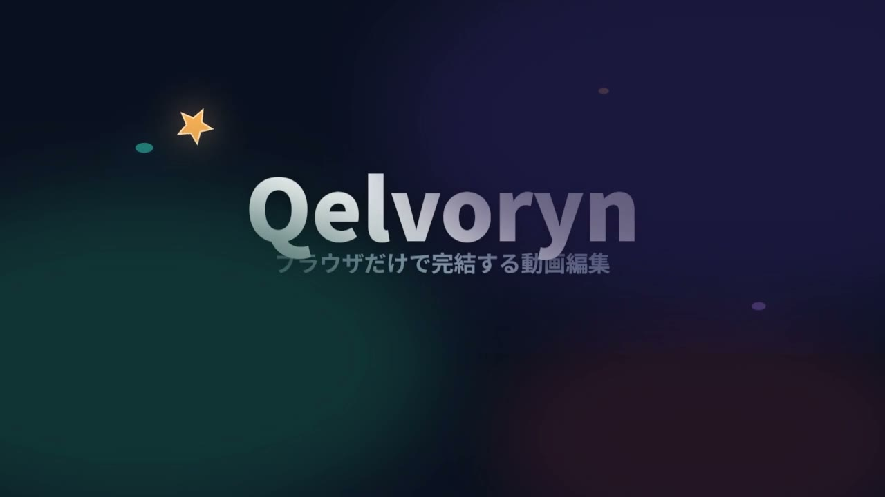

# Qelvoryn

ブラウザだけで動く、依存ゼロのノンリニア動画編集ソフト。
すべての処理 (デコード・合成・音声・書き出し・保存) がローカルで完結し、ファイルが外部へ送信されることはありません。

**使ってみる:** リポジトリを GitHub Pages で開くか、ローカルで `npm run serve` を実行して <http://localhost:5173> を開いてください。
ビルド手順はありません (静的ファイルのみ)。

## 主な機能

- **レイヤー方式マルチトラック編集** — 動画・音声・テキストをトラックで区別しません。レイヤーを何本でも追加でき、各レイヤーに動画・音声・画像・字幕・図形・エフェクトを自由に配置できます (置き場所が埋まっていれば自動で新レイヤーを作成)。レイヤーの複製・並べ替え・ドラッグ移動・トリム・スナップ・分割 (K)・リップル削除。
- **字幕** — ツールバーの「字幕」ボタンで再生ヘッドに字幕を追加し、その場でテキスト入力 (Enter またはダブルクリックでも編集)。SRT / VTT / テキストからの一括字幕生成は「AI演出」ダイアログから。
- **タイムライン** — 整数ティック (1/120000 秒) による正確な時間管理。24 / 23.976 / 25 / 29.97 / 30 / 50 / 59.94 / 60 fps すべてで 1 フレームが端数なしの整数ティックになります。
- **キーフレーム** — 位置・スケール・回転・不透明度・音量・エフェクトパラメータなど、ほぼ全ての値がアニメーション可能。補間は linear / ease / bezier / hold。
- **エフェクト** — クリップエフェクト (色補正・ぼかし・クロマキー・マスクなど) とフレームエフェクト (カメラ変換ズーム・グレイン・ビネットなど)。
- **音声** — WebAudio での波形表示・再生・音量 / EQ / ディレイ / フェード。
- **自動演出 (AI 補助)** — 実際のフレーム差分解析によるクリック検出からの自動ズーム・クリックリング、SRT/VTT/テキストからの字幕生成。生成物は通常のトラック/クリップなので 1 回の Undo で取り消せ、手動編集を上書きしません。
- **書き出し** — MediaRecorder による WebM / MP4 (対応ブラウザ) 書き出し、作業範囲指定、PNG スチル書き出し。
- **自動保存** — 編集内容は IndexedDB に自動保存され、次回起動時に復元されます。プロジェクトは JSON (.qelvoryn.json) として書き出し / 読み込み可能。

## デモ



- **デモ動画** — [demo/demo.mp4](demo/demo.mp4) (公開サイト: <https://rinderdragon0823.github.io/Qelvoryn/demo/demo.mp4>)。Qelvoryn 自身のエンジン (`renderFrame`) で全フレームをレンダリングした 20 秒のショートデモです。レイヤー合成・図形アニメーション・キーフレーム・字幕・カメラズーム・ビネット・サウンドトラック入り。
- **デモプロジェクト** — [demo/demo.qelvoryn.json](demo/demo.qelvoryn.json)。アプリ上部の **「デモ」ボタン** で読み込むか、JSON を開いてそのまま編集できます。
- **再生成** — `node tools/make-demo.mjs` (ヘッドレス Chrome/Edge と ffmpeg が必要。アプリ本体は依存ゼロのまま)。

## キーボードショートカット

| キー | 動作 |
| --- | --- |
| Space | 再生 / 停止 |
| ← / → | 1 フレーム移動 (Shift で 1 秒) |
| Home / End | 先頭 / 末尾へ |
| Enter | 選択中の字幕 / テキストを編集 |
| K (または Ctrl+K) | 再生ヘッド位置で分割 |
| T | 全トラックを分割 |
| I / O | 作業範囲の開始 / 終了 (Alt+X で解除) |
| M | マーカー追加 |
| S | スナップ切替 |
| F | 全体表示 (ズームフィット) |
| Ctrl+Z / Ctrl+Shift+Z | Undo / Redo |
| Ctrl+D | 複製 |
| Ctrl+A | 全選択 |
| Ctrl+S | プロジェクトを JSON 保存 |
| Ctrl+E | 書き出し |

## 開発

```sh
npm test     # ロジックテスト (Node, 依存ゼロ)
npm run serve  # 静的サーバ (http://localhost:5173)
```

ブラウザ統合テストは `tests.html` を開くと実行されます (canvas 合成・WebAudio デコード・IndexedDB 保存・MediaRecorder 書き出しを実ブラウザ API で検証)。

## AI 連携 (MCP)

`tools/mcp-server.mjs` は Qelvoryn の編集コアを **MCP (Model Context Protocol) ツール**として公開する依存ゼロの stdio サーバーです。AI アシスタントからプロジェクトファイルを直接開き、レイヤー・テキスト/字幕・キーフレーム・カメラズーム・トリム・分割などを操作して保存できます。アプリとまったく同じエンジン (`src/core`) を使うため、編集結果はブラウザで開けばそのまま続きを編集できます。

### opencode

リポジトリ同梱の `opencode.json` に設定済みです。このリポジトリで opencode を再起動すればそのまま使えます。

```json
{
  "mcp": {
    "qelvoryn": {
      "type": "local",
      "command": ["node", "tools/mcp-server.mjs"],
      "enabled": true
    }
  }
}
```

### Claude Desktop など

`claude_desktop_config.json` の `mcpServers` に追加します:

```json
{
  "mcpServers": {
    "qelvoryn": {
      "command": "node",
      "args": ["C:/path/to/Qelvoryn/tools/mcp-server.mjs"]
    }
  }
}
```

### 主なツール

| カテゴリ | ツール |
| --- | --- |
| プロジェクト | `qelvoryn_open_project` / `qelvoryn_save_project` / `qelvoryn_project_summary` / `qelvoryn_set_project` |
| レイヤー | `qelvoryn_list_tracks` / `qelvoryn_add_layer` |
| クリップ | `qelvoryn_list_clips` / `qelvoryn_get_clip` / `qelvoryn_split_clip` / `qelvoryn_trim_clip` / `qelvoryn_set_clip_timing` / `qelvoryn_delete_clips` / `qelvoryn_duplicate_clips` |
| テキスト・字幕 | `qelvoryn_add_text` / `qelvoryn_add_subtitles` (SRT / VTT / TXT ファイル対応) |
| アニメーション・演出 | `qelvoryn_add_camera_zoom` / `qelvoryn_add_keyframe` / `qelvoryn_set_clip_prop` |
| その他 | `qelvoryn_add_marker` / `qelvoryn_set_work_area` / `qelvoryn_list_assets` |

時間はすべて秒 (小数可) で指定します。例:

> 「demo.qelvoryn.json を開いて、20 秒地点に 1.5 倍のカメラズームを 3 秒追加、SRT ファイルを字幕として読み込んで、保存して」

## デプロイ (GitHub Pages)

1. リポジトリを GitHub に push すると `.github/workflows/pages.yml` がロジックテストを実行し、成功後にサイトを自動公開します。
2. 初回のみ Settings → Pages の「Build and deployment」で Source を **GitHub Actions** に設定してください。
3. 公開 URL は `https://<ユーザー名>.github.io/<リポジトリ名>/` です。

ワークフローを使わず「Deploy from a branch」で `main` ブランチのルートを配信する方法でも動作します (ビルド不要・全パス相対・Jekyll 無効化済みのため)。

## 構成

```
index.html          エントリ
src/
  main.js           ブート
  app.js            アプリ本体 (全体の配線)
  core/             時間モデル・プロジェクトモデル・ストア (Undo) ・編集コマンド・キーフレーム・自動保存
  engine/           合成 (renderFrame) ・エフェクト・図形/テキスト描画
  audio/            WebAudio 再生・音声グラフ
  media/            素材プール・デコード・波形・IndexedDB
  export/           MediaRecorder 書き出し・スチル
  auto/             自動演出・クリック解析・字幕
  ui/               タイムライン・プレビュー・インスペクタ・素材・ツールバー・ダイアログ
styles/main.css     スタイル
tests/              Node ロジックテスト
tests.html          ブラウザ統合テスト
tools/serve.mjs     開発用静的サーバ
tools/make-demo.mjs デモ動画の生成 (ヘッドレス Chrome + ffmpeg)
tools/mcp-server.mjs  AI 連携 (MCP) サーバー
demo/               デモ動画 (demo.mp4) とデモプロジェクト
```

## 書き出しの注意

- 書き出しは実時間 (1x) で行われます。その間タブをアクティブに保ってください (バックグラウンドではフレームが間引かれます)。
- コンテナ候補: MP4 (H.264) → WebM (VP9 / VP8) の順に `MediaRecorder.isTypeSupported` で選択されます。
- 音声は WebAudio から直接ミックスされ、映像と一緒に記録されます。

## ライセンス

MIT
